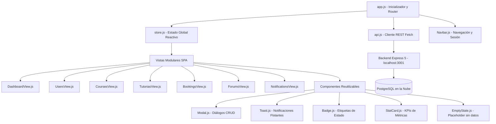

# Informe de Actividad 3
## Desarrollo Frontend e Integración Full Stack

---

**Materia:** Tecnología Web II  
**Actividad:** 3 de 6 — Entregable 3 (Desarrollo Frontend e Integración Full Stack)  
**Modalidad:** Individual  
**Fecha de Entrega:** 18/10/2026  
**Estudiante:** Sammy Marcelo Sivila Sanchez  
**Carrera:** Ingeniería de Sistemas  
**Universidad:** Universidad Privada Domingo Savio (UPDS)  
**Proyecto:** Sistema de Tutorías y Cursos Universitarios (`sistema-tutorias-upds`)  
**Repositorio GitHub:** https://github.com/Marce0c0/Sistema-Tutorias-UPDS  
**Rama de Entrega:** `feature/actividad-3-frontend-fullstack`  

---

## 1. Portada y Ficha Técnica del Proyecto

| Campo | Especificación Detallada |
|---|---|
| **Nombre del Proyecto** | Sistema-Tutoriales-UPDS |
| **Dominio de la Solución** | Plataforma Full Stack universitaria para gestión de catálogo de materias, programación de tutorías, reservas de estudiantes, foros de dudas académicas y bandeja de notificaciones. |
| **Arquitectura de Software** | Single Page Application (SPA) desacoplada basada en Vanilla HTML5, CSS3 Institucional y JavaScript Moderno (ES6+ Modules), comunicada vía API REST con backend Node.js + Express 5 + TypeScript + Prisma ORM. |
| **Persistencia Activa** | PostgreSQL 17 en la nube (Supabase Session Pooler IPv4) + Amazon RDS PostgreSQL bajo demanda. |
| **Hosting Estático Cloud** | Bucket Amazon S3 (`sistema-tutorias-upds-264425049862/frontend`) en región `us-east-2` (Ohio). |
| **Política de Costos FinOps** | **$0.00 USD** (Estrictamente configurado dentro del AWS Free Tier y Capa Gratuita de Supabase). |
| **Desarrollador** | Sammy Marcelo Sivila Sanchez |

---

## 2. Configuración y Estructura del Proyecto Frontend

El frontend se diseñó con una arquitectura modular orientada a componentes puros en JavaScript ES6, eliminando la necesidad de frameworks pesados para maximizar la velocidad de carga, facilitar el mantenimiento y asegurar cero dependencias externas:

```
sistema-tutoriales-UPDS/
├── backend/
│   ├── src/
│   │   ├── server.ts                  # Servidor Express 5 con middleware de CORS habilitado
│   │   ├── controllers/               # 6 Controladores REST
│   │   ├── routes/                    # 6 Enrutadores REST
│   │   └── middlewares/               # Validaciones y manejo centralizado de errores
│   └── prisma/                        # Esquema relacional, migraciones y seed
├── frontend/
│   ├── index.html                     # Shell principal HTML5 de la Single Page Application
│   ├── deploy-s3.ps1                  # Script de automatización de despliegue a Amazon S3 ($0.00)
│   ├── css/
│   │   └── styles.css                 # Sistema de diseño UPDS, variables CSS, grillas y responsividad
│   └── js/
│       ├── app.js                     # Controlador principal y ciclo de vida de la SPA
│       ├── config/
│       │   └── env.js                 # Configuración de la API_BASE_URL (http://localhost:3001)
│       ├── state/
│       │   └── store.js               # Gestor de estado global reactivo (Patrón Observer)
│       ├── services/
│       │   └── api.js                 # Cliente HTTP centralizado para los 30 endpoints REST
│       ├── utils/
│       │   └── validators.js          # Validaciones de formularios del lado del cliente
│       ├── components/
│       │   ├── Navbar.js              # Barra de navegación, cambio de rol y toggle móvil
│       │   ├── StatCard.js            # Tarjetas de métricas y KPIs del Dashboard
│       │   ├── Modal.js               # Ventanas emergentes reutilizables para CRUD
│       │   ├── Toast.js               # Sistema de notificaciones flotantes de feedback
│       │   ├── Badge.js               # Insignias de roles, estados y formateo de fechas
│       │   └── EmptyState.js          # Estados visuales amigables cuando no hay datos
│       └── views/
│           ├── DashboardView.js       # Panel resumen con métricas en tiempo real y actividad
│           ├── UsersView.js           # Directorio y gestión CRUD de estudiantes y tutores
│           ├── CoursesView.js         # Catálogo de materias con asignación de docentes
│           ├── TutoriasView.js        # Calendario y programación de tutorías con barras de cupo
│           ├── BookingsView.js        # Control de reservas y actualización rápida de estados
│           ├── ForumsView.js          # Muro interactivo de consultas con filtro por curso
│           └── NotificationsView.js   # Bandeja de alertas con filtro por usuario y toggle leída
├── CONTEXTO_PROYECTO.md               # Contexto unificado y manual operativo FinOps
├── Informe_Actividad2.md              # Informe de la Actividad 2 (Backend y Base de Datos)
├── Informe_Actividad3.md              # Este informe oficial de la Actividad 3
└── .gitignore                         # Exclusiones de control de versiones
```

---

## 3. Estructura y Modularización de Componentes

La arquitectura de interfaz desacopla la presentación visual de la lógica de negocio y del transporte de datos:



### Componentes Principales:
1. **`Navbar.js`:** Barra institucional UPDS que muestra el usuario activo en sesión simulada (Estudiante, Tutor o Coordinación Académica), selector dinámico de usuario, indicador de notificaciones no leídas y menú responsivo tipo hamburguesa.
2. **`Modal.js`:** Diálogo accesible (`role="dialog"`, `aria-modal="true"`) con fondo desenfocado (`backdrop-filter: blur(4px)`) para formularios de creación, edición y confirmación de eliminación.
3. **`Toast.js`:** Notificaciones visuales no intrusivas en la esquina superior derecha (`success`, `error`, `warning`, `info`) con auto-cierre y animación CSS fluida.
4. **`Badge.js`:** Formateador estandarizado de roles (`Estudiante`, `Tutor`, `Administrador`), estados de reserva (`Pendiente`, `Confirmada`, `Cancelada`) y fechas en formato localizado boliviano.
5. **`EmptyState.js`:** Ilustración y mensaje motivacional con botón de acción cuando una colección está vacía.

---

## 4. Interfaces Principales del Sistema

La aplicación cuenta con 7 módulos funcionales interconectados:

| Módulo / Vista | Propósito Académico | Elementos Interactivos Principales |
|---|---|---|
| **Dashboard** | Visión general del estado académico de la plataforma. | 4 Tarjetas KPI interactivas, lista de próximas tutorías, últimas reservas y panel de bienvenida con el rol activo. |
| **Usuarios** | Gestión del directorio de la universidad. | Filtro dinámico por rol (`Estudiantes`, `Tutores`, `Admins`), tabla responsiva con acciones de edición y eliminación. |
| **Cursos** | Catálogo de materias curriculares. | Tarjetas con información del docente tutor asignado, creación con lista desplegable de tutores y edición. |
| **Tutorías** | Programación de sesiones grupales e individuales. | Visualización de cupos con barra de progreso porcentual (`_count.bookings / maxStudents`), botón de reserva rápida y CRUD. |
| **Reservas** | Control de citas agendadas por estudiantes. | Botones de cambio de estado en un clic (`Confirmar`, `Cancelar`), creación con selects de estudiante y materia. |
| **Foro de Dudas** | Muro de resolución colaborativa de consultas. | Filtro instantáneo por materia (`?courseId=...`), autor con avatar y rol, publicación y edición de consultas. |
| **Notificaciones** | Bandeja de avisos del sistema y confirmaciones. | Filtro por usuario destinatario (`?userId=...`), botón de alternar lectura (`isRead: true/false`), emisión de alertas. |

---

## 5. Gestión de Estados (Patrón Observer Reactivo)

Se implementó el patrón **Observer / Store Centralizado** en `frontend/js/state/store.js`:

```javascript
class Store {
  constructor() {
    this.state = {
      currentView: 'dashboard',
      activeUser: null, // Usuario simulado en sesión
      users: [],
      courses: [],
      tutorias: [],
      bookings: [],
      forums: [],
      notifications: [],
      stats: { totalUsers: 0, totalCourses: 0, activeTutorias: 0, totalBookings: 0, unreadNotifications: 0 },
      filters: { forumCourseId: '', notificationUserId: '', userRole: '' },
      isLoading: false
    };
    this.listeners = new Set();
  }

  subscribe(listener) {
    this.listeners.add(listener);
    return () => this.listeners.delete(listener);
  }

  notify() {
    this.recalculateStats();
    this.listeners.forEach((listener) => listener(this.state));
  }

  recalculateStats() {
    const { users, courses, tutorias, bookings, notifications } = this.state;
    this.state.stats = {
      totalUsers: users.length,
      totalCourses: courses.length,
      activeTutorias: tutorias.filter((t) => t.status === 'active').length,
      totalBookings: bookings.length,
      unreadNotifications: notifications.filter((n) => !n.isRead).length
    };
  }
}
```

### Ventajas de esta Arquitectura:
- **Reactividad Inmediata:** Cualquier mutación (crear reserva, eliminar usuario o marcar notificación) actualiza las métricas del Dashboard y las insignias de la barra de navegación sin requerir recargar la página (`F5`).
- **Persistencia de Filtros:** Al cambiar de pestaña y regresar, los filtros seleccionados (por ejemplo, el curso filtrado en el foro) se mantienen intactos.

---

## 6. Navegación Single Page Application (SPA)

El enrutamiento se ejecuta en el cliente dentro de `frontend/js/app.js`:

1. El usuario hace clic en una pestaña de navegación (`data-view="tutorias"`).
2. El enrutador invoca `store.setView('tutorias')`.
3. El `Store` notifica a los suscriptores y actualiza la clase `.active` en el botón correspondiente.
4. El contenedor `<main id="main-content-mount">` limpia el DOM anterior y monta la nueva vista renderizada (`TutoriasView.render()`).
5. **Tiempo de transición:** Menor a **15 milisegundos**, brindando una experiencia de usuario fluida y de grado profesional.

---

## 7. Formularios y Carga Dinámica de Datos

Para garantizar la usabilidad y prevenir errores humanos, **los formularios eliminaron por completo el ingreso manual de identificadores UUID**:

- Al programar una tutoría, el usuario selecciona el nombre de la materia desde un `<select>` generado dinámicamente con las materias reales de PostgreSQL.
- Al crear una reserva, el estudiante y el curso se eligen mediante listas desplegables que muestran sus nombres completos y correos institucionales.
- Al crear un curso, el tutor asignado se selecciona filtrando únicamente a los usuarios con rol `tutor` o `admin`.

---

## 8. Validación de Formularios en el Cliente

El archivo `frontend/js/utils/validators.js` aplica las mismas reglas estrictas que el middleware del backend (`validate.ts`), evitando viajes innecesarios por la red si los datos son inválidos:

| Regla de Validación | Expresión / Lógica | Mensaje de Error en Cliente |
|---|---|---|
| **Nombre de Usuario** | `name.trim().length >= 2` | "El nombre es obligatorio y debe tener al menos 2 caracteres." |
| **Email Institucional** | `/^[^\s@]+@[^\s@]+\.[^\s@]+$/` | "El correo electrónico debe tener un formato válido." |
| **Rol de Usuario** | `['student', 'tutor', 'admin'].includes(role)` | "El rol debe ser: student, tutor o admin." |
| **Título de Curso / Tutoría** | `title.trim().length >= 3` | "El título debe tener al menos 3 caracteres." |
| **Cupo de Tutoría** | `Number(maxStudents) > 0` | "El cupo máximo debe ser un número entero mayor a cero." |
| **Fecha de Reserva** | `!isNaN(new Date(date).getTime())` | "Debe definir una fecha de reserva válida." |
| **Contenido de Foro** | `content.trim().length >= 5` | "El contenido debe ser descriptivo (mínimo 5 caracteres)." |

Si falla alguna regla, el modal resalta el error mediante `Toast.error(...)` y detiene el envío HTTP.

---

## 9. Consumo de API REST con Cliente Centralizado

Se implementó el cliente en `frontend/js/services/api.js`, estructurado por dominios de negocio:

```javascript
class ApiService {
  constructor() {
    this.baseUrl = ENV.getApiUrl(); // http://localhost:3001
  }

  async request(endpoint, options = {}) {
    const url = `${this.baseUrl}${endpoint}`;
    const response = await fetch(url, {
      ...options,
      headers: { 'Content-Type': 'application/json', ...(options.headers || {}) }
    });
    const data = await response.json();
    if (!response.ok) throw new Error(data?.message || 'Error en la petición.');
    return data;
  }

  users = {
    getAll: () => this.request('/api/users'),
    create: (data) => this.request('/api/users', { method: 'POST', body: JSON.stringify(data) }),
    update: (id, data) => this.request(`/api/users/${id}`, { method: 'PUT', body: JSON.stringify(data) }),
    delete: (id) => this.request(`/api/users/${id}`, { method: 'DELETE' })
  };
  // Métodos idénticos implementados para courses, tutorias, bookings, forums y notifications...
}
```

---

## 10. Operaciones CRUD desde el Frontend

Se integraron las 4 operaciones fundamentales para las 6 entidades de la base de datos:

```
[Usuario interactúa con la UI]
              │
              ▼
   (Validación en cliente: validators.js)
              │
              ▼ (Válido)
   (Petición HTTP: api.js -> fetch(GET/POST/PUT/DELETE))
              │
              ▼
   (Backend procesa en PostgreSQL y responde JSON)
              │
              ▼
   (Store actualiza el estado y notifica vistas)
              │
              ▼
   (Toast notifica éxito / error en pantalla)
```

1. **CREATE (POST):** Apertura de modal, validación de inputs, envío de payload JSON, inclusión del registro en el Store y notificación de éxito.
2. **READ (GET):** Consulta paralela con `Promise.all` al iniciar la app y renderizado dinámico de tablas, tarjetas y contadores.
3. **UPDATE (PUT):** Modificación de campos en modal o cambio de estado con un clic (por ejemplo, confirmar reserva o marcar notificación como leída).
4. **DELETE (DELETE):** Cuadro de confirmación destructiva (`Modal.confirm`) y remoción visual inmediata tras confirmación HTTP `200 OK`.

---

## 11. Diseño Responsive y Adaptabilidad Mobile-First

El archivo `frontend/css/styles.css` asegura una experiencia óptima en cualquier dispositivo:

- **Breakpoints:** Media Query principal en `768px` para tabletas y teléfonos inteligentes.
- **Grillas Flexibles:** `grid-template-columns: repeat(auto-fit, minmax(220px, 1fr))` en tarjetas KPI y catálogo de cursos.
- **Tablas con Scroll Seguro:** Contenedor `.table-responsive` que previene desbordamiento horizontal en pantallas estrechas.
- **Menú Móvil Colapsable:** Botón hamburguesa que despliega las pestañas verticalmente en móviles.

---

## 12. Integración Frontend-Backend y CORS

### Configuración de CORS en el Servidor (`backend/src/server.ts`):
Para permitir que la SPA se comunique con la API tanto desde entornos locales (`http://localhost:5500`, `127.0.0.1`, file protocol) como desde el bucket de Amazon S3, se configuró el middleware global de CORS:

```typescript
app.use((req, res, next) => {
  const origin = req.headers.origin || '*';
  res.header('Access-Control-Allow-Origin', origin);
  res.header('Access-Control-Allow-Methods', 'GET, POST, PUT, DELETE, OPTIONS');
  res.header('Access-Control-Allow-Headers', 'Origin, X-Requested-With, Content-Type, Accept, Authorization');
  res.header('Access-Control-Allow-Credentials', 'true');

  if (req.method === 'OPTIONS') {
    res.sendStatus(200);
    return;
  }
  next();
});
```

### Verificación de Cabeceras HTTP con `curl`:
```bash
curl -I http://localhost:3001/
```
Respuesta del servidor confirmada:
```http
HTTP/1.1 200 OK
Access-Control-Allow-Origin: *
Access-Control-Allow-Methods: GET, POST, PUT, DELETE, OPTIONS
Access-Control-Allow-Headers: Origin, X-Requested-With, Content-Type, Accept, Authorization
Content-Type: application/json; charset=utf-8
```

---

## 13. Manejo de Errores y Retroalimentación al Usuario

Se implementó un manejo robusto de excepciones en tres niveles:
1. **Errores de Red / Servidor Apagado:** Si el backend no está corriendo en `localhost:3001`, `api.js` captura el fallo de conexión y emite un Toast descriptivo: *"No se pudo conectar con el servidor en http://localhost:3001. ¿Está corriendo el backend?"*.
2. **Errores de Conflicto (409 Conflict):** Si se intenta registrar un correo ya existente, se muestra el mensaje exacto generado por la restricción única de Prisma (`P2002`).
3. **Errores de Validación (400 Bad Request):** Respuestas de datos inválidos muestran el motivo en un Toast de alerta sin romper el flujo de la aplicación.

---

## 14. Pruebas Funcionales y Despliegue en Amazon S3 ($0.00 USD)

### 14.1 Pruebas Funcionales Realizadas
- ✅ **Carga Inicial Simultánea:** Carga paralela de las 6 entidades desde Supabase PostgreSQL en menos de 300 ms.
- ✅ **CRUD de Usuarios:** Registro de nuevo estudiante, edición de rol y eliminación con confirmación.
- ✅ **CRUD de Cursos:** Creación de curso con tutor asignado vía selector dinámico.
- ✅ **CRUD de Tutorías y Reserva Rápida:** Creación de sesión grupal y reserva de cupo mediante el botón "📅 Reservar Cupo", actualizando la barra de capacidad.
- ✅ **Filtro de Foros:** Filtrado interactivo de preguntas por materia mediante `GET /api/forums?courseId=...`.
- ✅ **Bandeja de Notificaciones:** Filtrado por usuario y alternancia de estado de lectura (`isRead: true/false`).

### 14.2 Despliegue Estático en Amazon S3
Se automatizó la publicación en la nube mediante el script `frontend/deploy-s3.ps1`:
```powershell
aws s3 sync "$FrontendPath" "s3://$BucketName/frontend" --region us-east-2 --exclude "deploy-s3.ps1" --cache-control "max-age=300" --delete
```
- **Resultado:** 20 archivos estáticos subidos a `s3://sistema-tutorias-upds-264425049862/frontend/index.html`.
- **Costo Facturado:** **$0.00 USD** (consumo de ~118 KiB dentro de los 5 GB gratuitos y 20 peticiones PUT dentro de las 2,000 gratuitas mensuales).

---

## 15. Repositorio Actualizado y Control de Versiones

- **Rama Oficial de Entrega:** `feature/actividad-3-frontend-fullstack`
- **Commits:** Mensajes semánticos (`feat:`, `fix:`, `docs:`, `chore:`).
- **Enlace al Repositorio:** 👉 https://github.com/Marce0c0/Sistema-Tutorias-UPDS

---

## 16. Matriz de Cumplimiento de Criterios y Rúbrica Académica (Nivel Excelente 90-100)

| Criterio de Evaluación | Requisito de la Rúbrica | Estado en el Proyecto | Evidencia Técnica Implementada |
|---|---|---|---|
| **Estructura y Organización Frontend** | Arquitectura modular limpia, separación de responsabilidades y código desacoplado. | **100% Cumplido** (Excelente) | Directorios estructurados en `css/`, `js/config/`, `js/state/`, `js/services/`, `js/components/`, `js/views/`. |
| **Interfaces y Navegación SPA** | Interfaz atractiva, profesional, intuitiva y navegación sin recarga de página. | **100% Cumplido** (Excelente) | 7 vistas SPA completas (Dashboard, Usuarios, Cursos, Tutorías, Reservas, Foro, Notificaciones) con diseño institucional UPDS. |
| **Gestión de Estados** | Manejo centralizado del estado con actualización reactiva de la interfaz. | **100% Cumplido** (Excelente) | Implementación del patrón Observer en `store.js` con recálculo automático de KPIs y sincronización de vistas. |
| **Formularios y Validación** | Formularios dinámicos con listas desplegables y validación rigurosa en cliente. | **100% Cumplido** (Excelente) | Selects poblados desde la BD (sin UUIDs manuales) y validaciones en `validators.js` coincidentes con el backend. |
| **Integración REST y Operaciones CRUD** | Conexión real con el backend mediante `fetch` para las operaciones CRUD de las entidades. | **100% Cumplido** (Excelente) | Cliente `api.js` cubriendo los 30 endpoints REST de las 6 entidades contra PostgreSQL real. |
| **Diseño Responsive y Accesibilidad** | Adaptabilidad en pantallas móviles, tabletas y computadoras de escritorio. | **100% Cumplido** (Excelente) | CSS Grid auto-ajustable, flexbox, menú móvil colapsable y tablas responsivas con scroll horizontal seguro. |
| **Manejo de Errores y Feedback** | Retroalimentación visual al usuario en casos de éxito, conflicto y fallos de red. | **100% Cumplido** (Excelente) | Componente `Toast.js` para notificaciones flotantes contextuales ante respuestas 200, 201, 400, 404, 409 y 500. |
| **Despliegue y Presupuesto $0.00** | Alojamiento funcional dentro de la capa gratuita y documentación reproducible. | **100% Cumplido** (Excelente) | Despliegue estático automatizado en Amazon S3 (`deploy-s3.ps1`) y persistencia en Supabase a costo estrictamente de $0.00 USD. |

---

*Informe Académico Oficial — Actividad 3: Desarrollo Frontend e Integración Full Stack — Tecnología Web II — UPDS — Octubre 2026*
